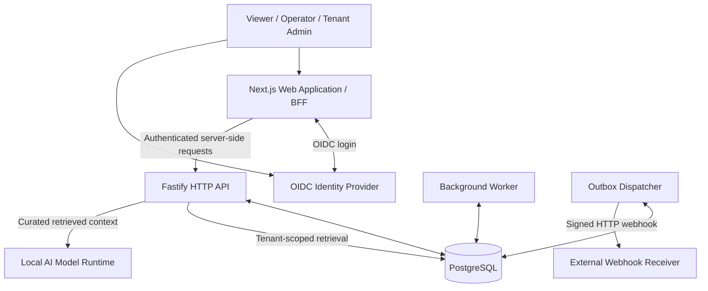

# Architecture 01 — System Context and Trust Boundaries

**Document status:** Proposed design baseline  
**Related backlog:** Epics 3–10  
**Decision record:** [Architecture decision register](06-decision-register.md)

## Purpose

The Enterprise Job Processing Platform is an internal, multi-tenant application for submitting and supervising asynchronous business operations. It accepts requests quickly and executes work separately from the HTTP request lifecycle.

## Actors and external systems

| Actor / system           | Responsibility                                    | Trust boundary                                                            |
| ------------------------ | ------------------------------------------------- | ------------------------------------------------------------------------- |
| Viewer                   | Inspect jobs within an authorized organization    | Authenticated user, read-only                                             |
| Operator                 | Submit and cancel supported jobs                  | Authenticated user with scoped permissions                                |
| Tenant administrator     | Manage membership, roles and audit access         | Administrator for their own tenant only                                   |
| Identity provider        | Authenticate users, provide OIDC identity and MFA | External security authority for identity, **not** application permissions |
| Webhook receiver         | Accept outbound notifications                     | External service; delivery may be repeated                                |
| AI model runtime         | Generate answers from supplied context            | Untrusted model output; never authorizes requests                         |
| Engineering / operations | Deploy, monitor and recover the system            | Privileged operational access, separately controlled                      |

## Context diagram

## Security boundaries

1. **Browser to web application.** The browser is untrusted. UI state and hidden buttons do not establish permissions.
2. **Web application to API.** The server-side web layer forwards a verifiable identity assertion; the API still validates it and independently checks current membership and permissions.
3. **API to PostgreSQL.** Every tenant-owned resource lookup is tenant-scoped. A resource ID on its own is insufficient to authorize access.
4. **Worker to database.** Workers act on leased jobs. They do not inherit arbitrary browser identities.
5. **Dispatcher to receiver.** Webhooks are signed; the receiving system must handle duplicate deliveries using an event ID.
6. **Retrieval to model.** Documents are untrusted context, never privileged instructions. Authorization happens before retrieval.

## Excluded from this context

A billing system, public developer portal, mobile app and separately deployed microservice fleet are not part of the initial release. Dedicated enterprise integrations may be added after their requirements are defined.

## Verification expectations

- Anonymous access to protected routes is rejected.
- Users from tenant A cannot read or mutate tenant B's resources, even with a valid ID.
- Job creation returns before lengthy processing completes.
- Worker interruption does not make the job permanently unreachable.
- A webhook failure does not roll back a committed business operation.

These are **acceptance targets**, not claims that production validation has already passed.
