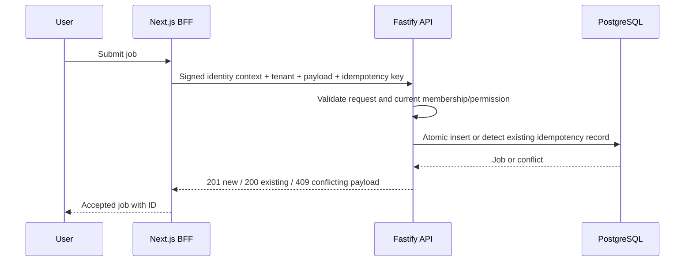

# Architecture 02 — Components, Responsibilities and Data Flow

**Document status:** Proposed design baseline  
**Related backlog:** Epics 1–8

## Runtime components

| Component | Primary responsibility | Does not own |
| --- | --- | --- |
| `apps/web` | Authenticated Next.js interface, server-side BFF calls, presentation | Final authorization or direct SQL |
| `apps/api` | HTTP contracts, validation, identity verification, current authorization, job commands and queries | Long-running job execution |
| `apps/worker` | Claim jobs, execute supported work, heartbeat, retries and terminal state updates | Login and interactive requests |
| `apps/dispatcher` | Claim pending notifications, sign and deliver webhooks, record attempts | Original business transaction |
| PostgreSQL | Durable jobs, memberships, idempotency, audit, outbox, tenant documents | Interactive UI rendering |
| Keycloak / OIDC provider | User authentication and optional MFA policy | Per-job business authorization |
| Local model runtime | Generate answers from retrieved permitted documents | Access-control decisions |

## Shared code packages

The planned workspace has `packages/contracts`, `packages/engine`, and `packages/database` as its foundational shared packages. A separate auth or observability package is optional **only if** the implementation evolves to need one; do not invent packages in repository diagrams before creating them.

- `contracts`: runtime schemas and static TypeScript types.
- `engine`: job execution and concurrency utilities, retry primitives and supporting algorithms.
- `database`: connection management, migrations and common persistence helpers.

## Flow A — Submit a job

A request's idempotency key is unique **within a tenant**. A repeated identical request yields the previous job. The same key with a different normalized payload produces a conflict.

## Flow B — Execute and recover a job

1. A worker polls for eligible `queued` jobs or expired `running` leases.
2. PostgreSQL row locking (`FOR UPDATE SKIP LOCKED`) prevents concurrent claims of the same row.
3. The worker records ownership and a lease deadline, then executes the job.
4. A heartbeat extends the lease while the worker is active.
5. Completion updates the job and any database-side effects in a transaction, conditional on retaining the lease.
6. Failure schedules a bounded retry; exhausted jobs transition to `failed`.
7. If the worker crashes, another worker may reclaim an expired lease.

**Semantics:** At-least-once execution. External side effects must be designed for idempotency because a crash may lead to re-execution.

## Flow C — Deliver a notification

1. A notification job completes and writes a durable outbox record in the same transaction.
2. The dispatcher leases an eligible outbox message.
3. It signs a webhook and sends an HTTP request to the configured receiver.
4. Successful delivery marks the message `delivered`.
5. Failures are retried with backoff; exhausted deliveries may be marked `dead` for operator intervention.

Delivery is **not exactly once**. Receivers should deduplicate using the stable notification identifier.

## Flow D — Ask the AI assistant

1. Verify the user's identity and membership.
2. Restrict retrieval by authorized `tenant_id` before model input is assembled.
3. Generate a response using only selected source context.
4. Include attributable sources or report insufficient evidence.
5. Record latency, retrieval quality and prohibited cross-tenant access attempts in tests.

## Architecture constraints

- API/domain validation cannot be bypassed via UI shortcuts.
- SQL filtering is mandatory for tenant-owned data.
- Shared packages do not import application runtime entrypoints.
- Expensive business work does not execute in a Next.js request handler.
