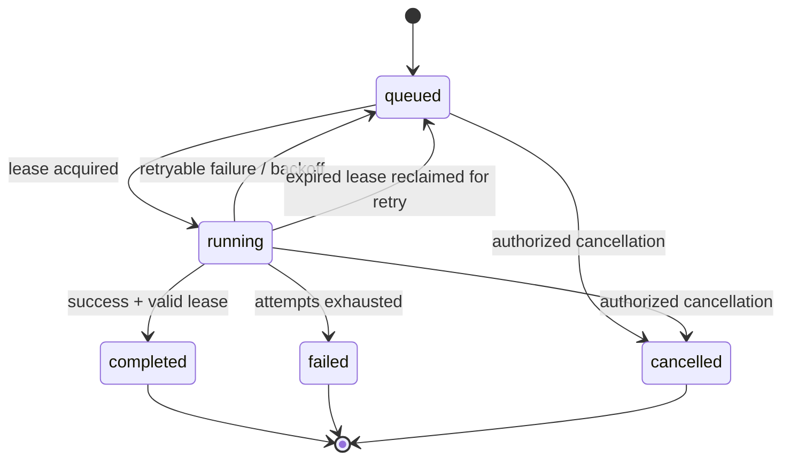

# Architecture 04 — Job State Machine, Idempotency and Recovery

**Document status:** Design baseline  
**Related backlog:** Epics 3, 5, 6, 7

## Supported job types

| Type | Input | Intended result |
| --- | --- | --- |
| `report` | Bounded array of numbers | Summary statistics |
| `import` | Bounded records with external IDs | Idempotent import/update |
| `notification` | Subject and message | Durable outbox message for delivery |

## Job states

The database-backed workflow uses the following states: `queued`, `running`, `completed`, `failed`, `cancelled`.

`retrying` is a **behavior**, not a separate persisted state in this baseline; pending retries remain `queued` with a future availability timestamp. A later manual retry feature requires its own transition and acceptance tests.

## Invariants

1. A job is owned by exactly one tenant.
2. `(tenant_id, idempotency_key)` identifies one logical create request.
3. The request fingerprint is compared when an idempotency key is reused.
4. Only a valid current lease owner may commit a running job's completion.
5. Attempts are bounded by `max_attempts`.
6. A canceled or expired-lease job must not be incorrectly marked complete by an old worker.
7. Side effects must be designed for replay, because worker execution is at least once.

## Concurrency model

The baseline uses PostgreSQL transactions and row locking with `FOR UPDATE SKIP LOCKED` to claim eligible jobs. A lease owner and lease expiration timestamp are recorded. Workers periodically heartbeat, and another worker may reclaim work after an expired lease.

This simplifies the initial architecture by reusing PostgreSQL, but the database can become a bottleneck at high polling volume. Queue acquisition, lock waits and transaction duration must be measured under realistic load.

## Failure cases to test

| Failure | Expected outcome |
| --- | --- |
| Worker exits immediately after claiming a job | Lease expires and work becomes reclaimable |
| Worker loses lease before finishing | Old worker cannot commit completion |
| Job fails twice then succeeds | Attempts are recorded and final state is completed |
| Job exceeds allowed attempts | Final state becomes failed |
| Two workers claim concurrently | A single claim owner per attempt |
| Duplicate import record | Defined upsert/idempotency behavior |
| Duplicate notification attempt | Outbox identity prevents duplicate logical outbox records |

## Outbound side effects

The notification flow uses a transactional outbox: the job transaction creates a persistent delivery record, and a separate dispatcher performs HTTP delivery. This prevents the "commit succeeded, notification was lost" gap. It does **not** prove the receiver processed exactly one request; receiver deduplication remains necessary.

## Operational metrics

- queued job count and oldest job age
- job time in queue
- active leases and expired leases
- attempts per job and failure rate
- processing duration by job type
- outbox backlog, oldest pending delivery and dead messages

See [Observability and SLOs](../operations/03-observability-and-slos.md).
